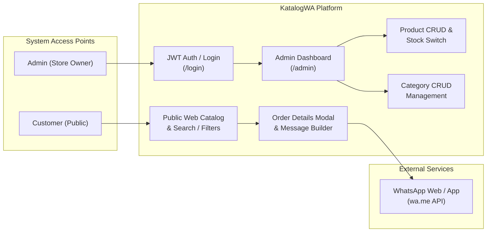
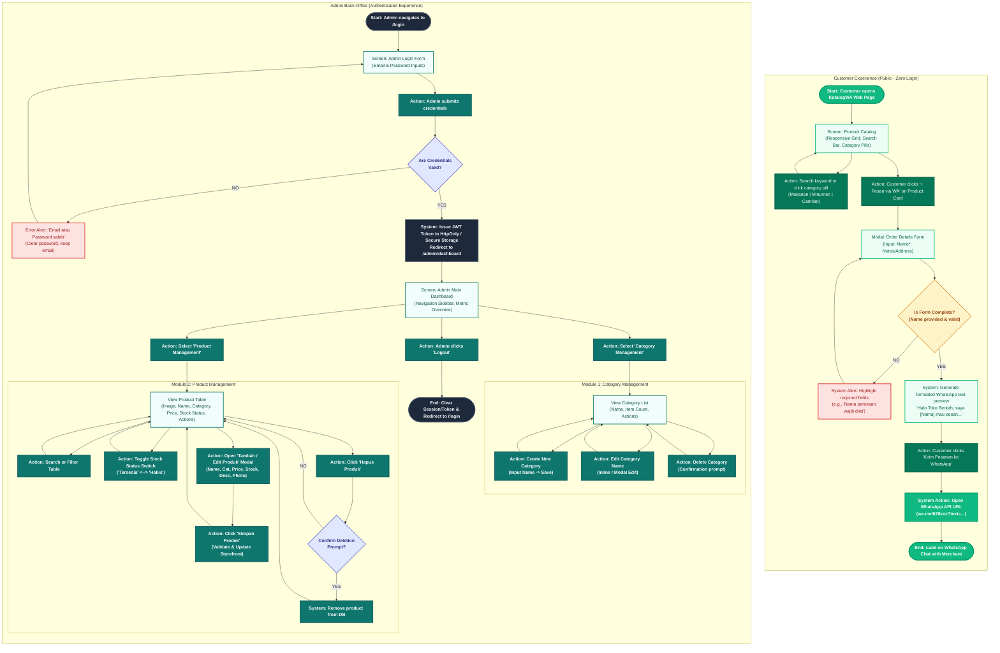

# KatalogWA — User Flow Diagram & Specification
**Local Business Product Catalog & WhatsApp Direct Ordering System**

---

## 1. High-Level Architecture & User Roles

KatalogWA operates on two distinct user planes:
- **Customer Plane (Public / Zero Friction):** No login, registration, or session state required. Direct catalog browsing, product filtering, quick modal order capture, and pre-formatted WhatsApp redirect (`wa.me`).
- **Admin Back-Office Plane (Protected / JWT-Secured):** Role-based access control, category taxonomy management, product catalog CRUD, and inventory status toggle ("Tersedia" / "Habis").



---

## 2. Comprehensive User Flow Diagram

The diagram below details both flows with designated color palettes:
- **Emerald Green (`#10B981`)** for Customer Experience & WhatsApp Actions
- **Slate & Dark Cyan (`#0F766E` / `#1E293B`)** for Admin Back-Office Operations
- **Decision Diamonds** for validation and authentication checkpoints



---

## 3. Detailed Step-by-Step Flow Specifications

### 3.1 Flow 1: Customer Order via WhatsApp

| Step # | Screen / State | User Action | System Processing & Validation | Outcome / Next State |
| :--- | :--- | :--- | :--- | :--- |
| **C1** | Landing (`/`) | Customer visits URL | Loads public catalog with real-time stock status from API | Render grid of product cards with photos, prices, category badges, and stock switches |
| **C2** | Catalog Grid | Type search or tap category pill (`Makanan`, `Minuman`, `Camilan`) | Client-side or server query filtering products matching criteria | Filtered grid view |
| **C3** | Product Card | Clicks `+ Pesan via WA` | Checks if product stock status is "Tersedia" (disabled if "Habis") | Opens Order Details Modal with pre-selected product info |
| **C4** | Order Modal | Fills `Nama Pemesan` and optional `Catatan / Alamat Pengiriman` | Form validation: `Name` must be non-empty (minimum 2 chars) | Dynamic preview updates below the form |
| **C5** | Validation Check | Clicks `Kirim Pesanan ke WhatsApp` | • **Invalid:** Highlights required fields with alert red boundary<br>• **Valid:** Encodes text using RFC 3986 `encodeURIComponent()` | Generates WhatsApp deep link |
| **C6** | Redirect | System executes redirection | Constructs `https://wa.me/{STORE_PHONE}?text={ENCODED_MESSAGE}` | Browser/Mobile OS launches WhatsApp application with pre-filled message |

#### WhatsApp Message Template Specification
```text
Halo Toko Berkah, saya [Nama Pemesan] mau pesan:
- Produk: [Nama Produk]
- Harga: Rp [Harga Produk]
- Catatan / Alamat: [Catatan atau "-"]

Terima kasih!
```

---

### 3.2 Flow 2: Admin Authentication & Product Management

| Step # | Module / Screen | Actor Action | Backend / Security Rules | Outcome |
| :--- | :--- | :--- | :--- | :--- |
| **A1** | `/login` | Inputs Email + Password and submits | POST to `/api/auth/login` | Validates credentials against hashed password |
| **A2** | Auth Decision | Credential verification | • **Failure:** Returns 401 Unauthorized<br>• **Success:** Returns Signed JWT token & user profile | Display alert if failed; store token in Secure Cookie / LocalStorage and route to `/admin` |
| **A3** | Dashboard (`/admin`) | Sidebar navigation | Verifies `Authorization: Bearer <token>` in auth guard | Displays Dashboard Overview |
| **A4** | Category Admin (`/admin/categories`) | Add / Edit / Delete category | Validate category unique slug and check for dependent products before deletion | Category table updates instantly |
| **A5** | Product Table (`/admin/products`) | Toggle Stock Switch (`Tersedia` / `Habis`) | Instant optimistic UI update + PATCH request to `/api/products/:id/stock` | Changes live availability immediately on public catalog |
| **A6** | Product Modal Form | Add / Edit product (Name, Category, Price, Stock, Description, Photo) | Form schema validation + multi-part image upload handling | Product is committed to database and reflected in table |
| **A7** | Product Deletion | Click delete -> Confirm alert | DELETE `/api/products/:id` with cascade cleanup | Product removed from catalog |
| **A8** | Logout | Click `Logout` button | Invalidate local token and trigger auth logout API | Redirects back to `/login` |

---

## 4. Key UX Best Practices for KatalogWA

1. **Zero-Friction Conversion for Customers:**
   - No account creation or OTP verification required for buyers.
   - WhatsApp redirect happens in one click after entering their name.
2. **Instant Visual Feedback:**
   - Out-of-stock items ("Habis") display a muted badge and disabled "+ Pesan via WA" button, preventing dead orders.
3. **One-Tap Quick Actions for Admin:**
   - Fast toggle for stock availability directly from the product table without opening the full edit modal.
   - Real-time search and category filtering in the admin table for fast inventory lookups during busy hours.
